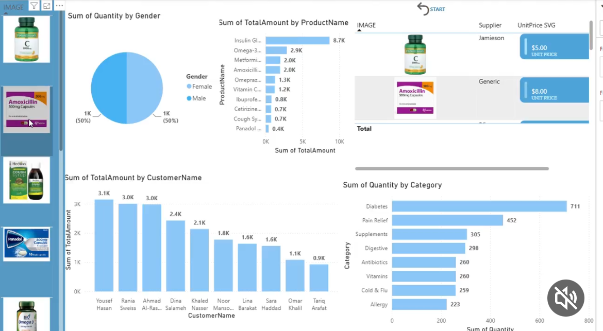
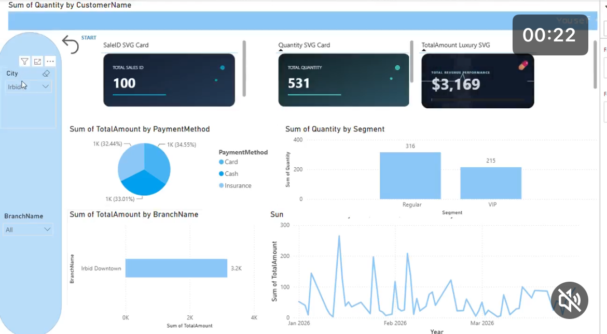

# Pharmacy Sales – Jordan

**Tool:** Power BI · Power Query · SVG cards  
**Domain:** Healthcare / Retail

One of my strongest projects. I used AI to generate a realistic dataset that simulates a real pharmacy in Jordan, then treated it like a real business project rather than a training exercise.

## What I did
- **Cleaned and prepared** the data with Power Query.
- **Built a clear data model** in Power BI.
- **Designed an interactive dashboard**, and used **SVG** for the first time to give the KPI cards a custom, non-standard look.
- Added **product images** as a visual navigation panel.

## What the dashboard shows
- **KPIs:** total sales transactions (100), total quantity (531), total revenue ($3,169)
- Revenue by **product**, **customer**, **branch** and **payment method** (card / cash / insurance)
- Quantity by **category** (Diabetes, Pain Relief, Supplements, Digestive, Antibiotics…), **gender** and **customer segment** (Regular vs VIP)
- **Daily revenue trend** (Jan–Mar 2026)
- Product table with supplier and unit price
- Filters for **city** and **branch**

## Screenshots

## What I learned
How to turn numbers into something simple and easy to understand, and how design choices can completely change the way people read the data.
