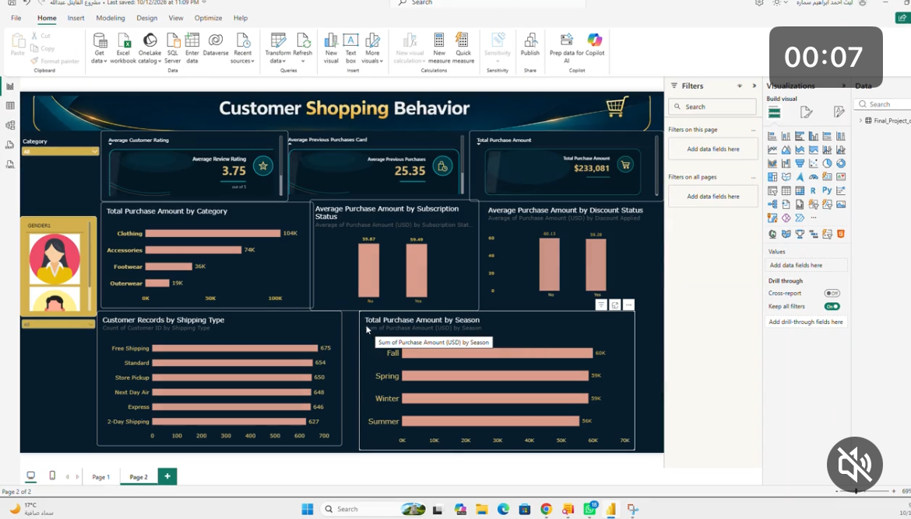

# Customer Shopping Behavior

**Tool:** Power BI · SVG · Image slicers  
**Context:** Final project of the Power BI course with **Apex Company** — coached by **Abdallah Sarhan**

## What the dashboard shows
- **KPIs:** average review rating (3.75), average previous purchases (25.35), total purchase amount ($233,081)
- Total purchase amount by **category**: Clothing (104K), Accessories (74K), Footwear (36K), Outerwear (19K)
- Average purchase amount by **subscription status** and by **discount status**
- Customer records by **shipping type** (Free, Standard, Store Pickup, Next Day Air, Express, 2-Day)
- Total purchase amount by **season**
- **Gender** picture slicer and category filter

## Techniques
- SVG KPI cards
- Picture-based slicers
- Dark, branded report theme

## Screenshot

## About this project
- **Data:** Practice dataset provided as part of the Apex Company Power BI course.
- **Files in this folder:** dashboard screenshots only. They were captured from the demo video I posted on LinkedIn, so some show a video timer or mute icon. The original report file and dataset are no longer available.
- **Role:** built individually.

[← Back to all projects](../README.md)
