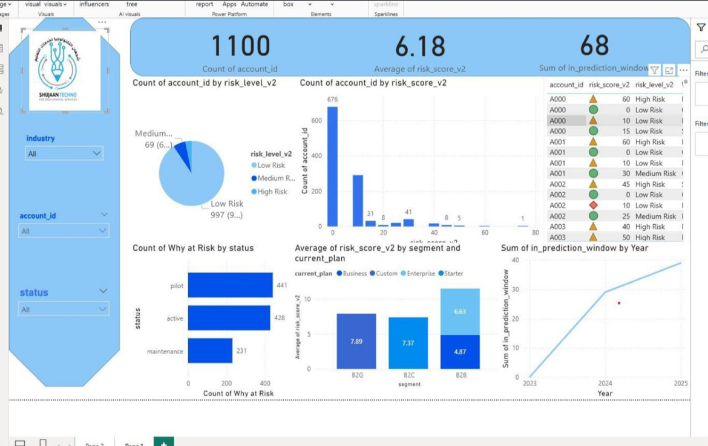

# Customer Risk Analysis

**Tool:** Power BI  
**Domain:** SaaS / Customer success

A dashboard that tracks which customer accounts are at risk, how risky they are, and why.

## What the dashboard shows
- **KPIs:** 1,100 accounts, average risk score 6.18, total prediction window 68
- Accounts by **risk level** (Low / Medium / High) and by **risk score**
- "Why at risk" by **account status** (pilot, active, maintenance)
- Average risk score by **segment** (B2B, B2C, B2G) and **current plan** (Starter, Business, Enterprise, Custom)
- Prediction window **trend by year** (2023–2025)
- Account-level table with **colour-coded risk indicators**
- Filters for industry, account and status

## Screenshot

## About this project
- **Data:** Practice dataset; account IDs are anonymized (e.g. A000, A001).
- **Files in this folder:** dashboard screenshots only. They were captured from the demo video I posted on LinkedIn, so some show a video timer or mute icon. The original report file and dataset are no longer available.
- **Role:** built individually.

[← Back to all projects](../README.md)
