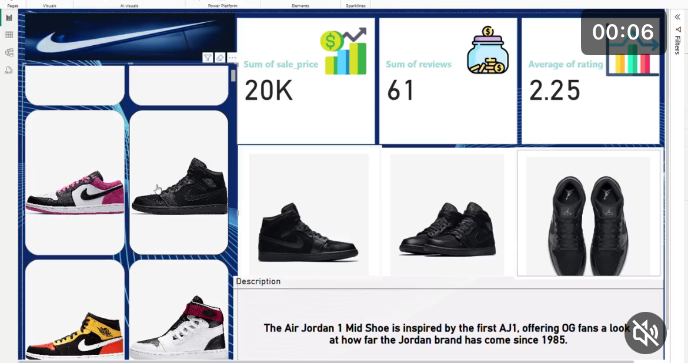

# Nike Products Dashboard

**Tool:** Power BI  
**Context:** Practical training on Nike test data — thanks to **Eng. Abdallah Abu Al-Olayan** for his support.

## What the dashboard shows
- **KPIs:** total sale price (20K), total reviews (61), average rating (2.25)
- **Product image gallery** — click a shoe to filter the whole page
- Product photos from different angles
- Product **description** that updates with the selection

## Techniques
- Image-based navigation and filtering
- Custom KPI cards with icons
- Branded layout

## Screenshot

