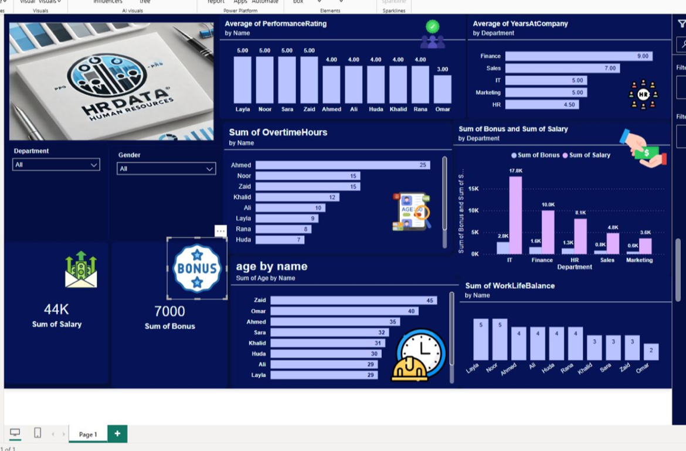

# HR Analytics Dashboard

**Tool:** Power BI  
**Domain:** Human Resources

## What the dashboard shows
- **KPIs:** total salary (44K), total bonus (7,000)
- Average **performance rating** by employee
- Average **years at company** by department
- **Overtime hours** by employee
- **Salary and bonus** by department
- **Age** by employee
- **Work-life balance** score by employee
- Filters for department and gender

## Key insights
- Some employees carry a lot of overtime — one worked **25 extra hours**, which opens a discussion about balancing workload across the team.
- **IT** has the highest salaries and bonuses, which matches market demand for those skills, but raises the question of how to improve rewards in other departments.
- Employee satisfaction with **work-life balance** is good overall, with room to improve in some areas.

## Screenshot

## About this project
- **Data:** Practice HR dataset; employee names are sample data, not real employees.
- **Files in this folder:** dashboard screenshots only. They were captured from the demo video I posted on LinkedIn, so some show a video timer or mute icon. The original report file and dataset are no longer available.
- **Role:** built individually.

[← Back to all projects](../README.md)
