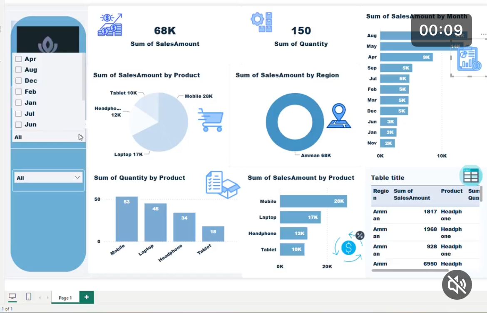

# Sales Dashboard – Jordan Branches

**Tool:** Power BI  
**Domain:** Sales

An interactive dashboard that gives management a full view of sales across branches.

## What the dashboard shows
- **Overall KPIs:** total sales (68K) and total quantity (150) at a glance
- **Regional performance:** compare branches in Amman, Irbid, Zarqa and Aqaba
- **Monthly trends:** spot peak and weak months
- **Product comparison:** sales vs. quantity for each product (Mobile, Laptop, Headphone, Tablet)
- Detail table by region and product
- Month and region filters

## Screenshot

## About this project
- **Data:** Practice sales dataset.
- **Files in this folder:** dashboard screenshots only. They were captured from the demo video I posted on LinkedIn, so some show a video timer or mute icon. The original report file and dataset are no longer available.
- **Role:** built individually.

[← Back to all projects](../README.md)
