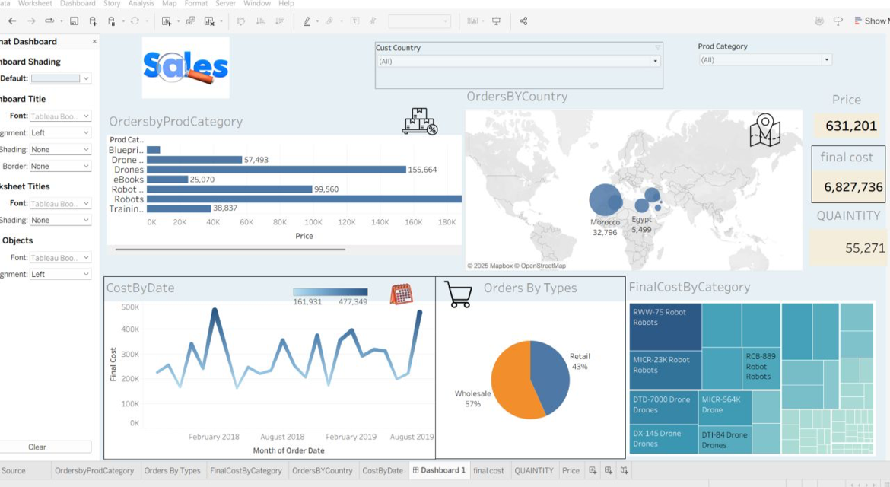

# SuperStore Sales Dashboard

**Tool:** Tableau  
**Context:** Thanks to **Dr. Mohammad Al Khaldy** for his support in understanding Tableau concepts.

## What the dashboard shows
1. **Orders by product category** — bar chart (Drones, Robots, eBooks, Blueprints, Training…)
2. **Orders by country** — interactive map with bubble size showing order volume
3. **Cost trend over time** — line chart of final cost across months and years, to spot seasonal peaks and drops
4. **Orders by type** — pie chart: Wholesale 57% vs Retail 43%
5. **Final cost by category** — treemap of the most costly categories
6. **KPIs** — Price (631,201), Final Cost (6,827,736), Quantity (55,271)

Filters for customer country and product category.

## Screenshot

