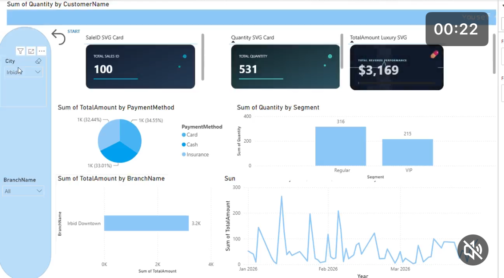
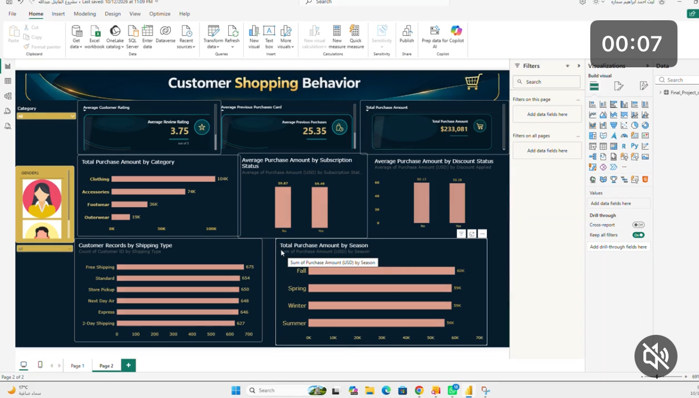
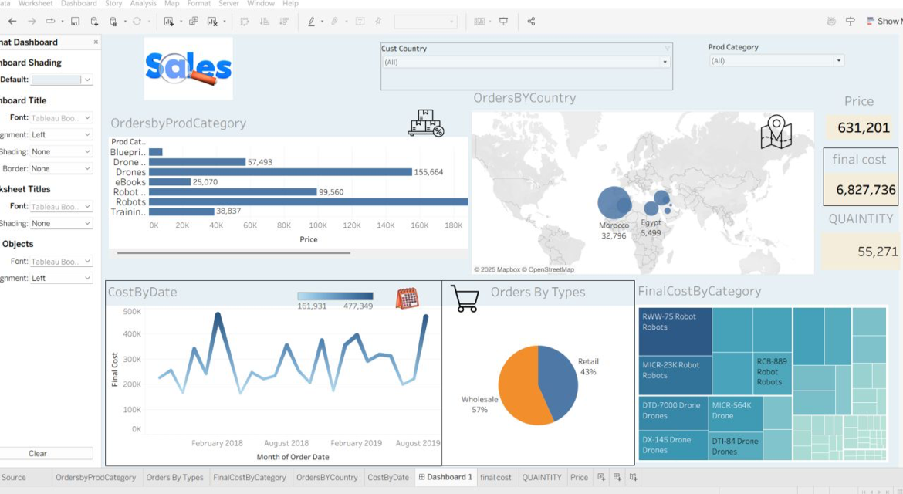

# Laith Samara — Data Analytics Portfolio

**Data Analyst | Excel • SQL • Power BI • Tableau**

I turn raw data into clear, interactive dashboards that help people make better decisions.
This repository collects the dashboard projects I've built and shared on LinkedIn.

---

## Projects

| # | Project | Tool | Domain |
|---|---------|------|--------|
| 01 | [Pharmacy Sales – Jordan](01-pharmacy-sales-jordan) | Power BI · Power Query · SVG | Healthcare / Retail |
| 02 | [Customer Shopping Behavior](02-customer-shopping-behavior) | Power BI · SVG · Image slicers | Retail / E-commerce |
| 03 | [Customer Risk Analysis](03-customer-risk-analysis) | Power BI | SaaS / Customer success |
| 04 | [Nike Products Dashboard](04-nike-products-dashboard) | Power BI | Retail / Products |
| 05 | [HR Analytics Dashboard](05-hr-analytics-dashboard) | Power BI | Human Resources |
| 06 | [Sales Dashboard – Jordan Branches](06-sales-dashboard-jordan-branches) | Power BI | Sales |
| 07 | [SuperStore Sales Dashboard](07-superstore-tableau-dashboard) | Tableau | Sales / Operations |

---

## Highlights

---

## Skills

- **Power BI:** data modeling, Power Query (cleaning & shaping), DAX measures, interactive slicers, SVG cards, image slicers
- **Tableau:** maps, treemaps, trend lines, KPI tiles, dashboard actions
- **Excel:** data preparation, formulas, pivot tables
- **SQL:** querying and preparing data for analysis

## Contact

Find me on LinkedIn — **Laith Samara**.
